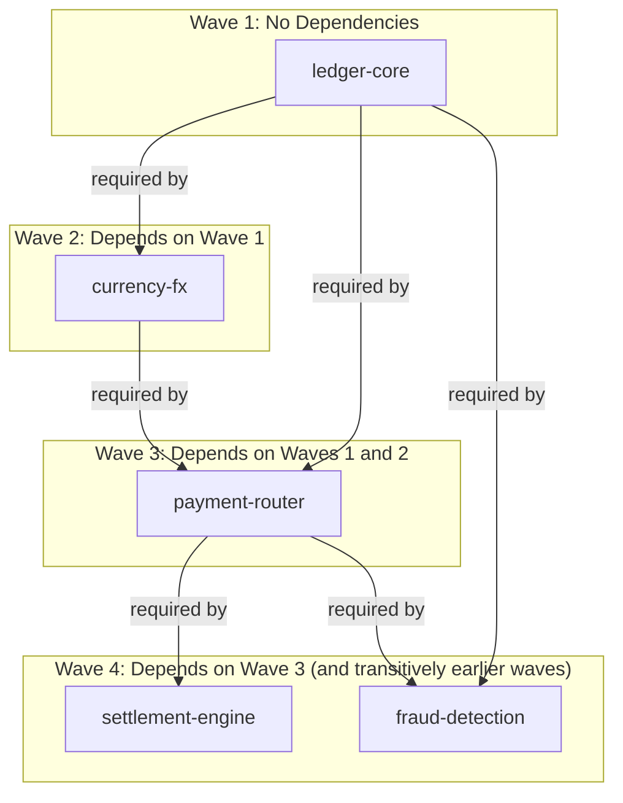

# Use Iteration to upgrade a series of repositories
Dependency chains break silently. A change to ledger-core can pass its own tests and still 
break fraud-detection three layers downstream if a version pin goes stale in between. Chasing that
failure back through payment-router and currency-fx costs hours, usually during an incident,
not during normal development.

Before this prompt, an engineer pushed ledger-core, then watched the pipeline dashboard in
a browser tab until it passed. They opened the pipeline logs to find the new version number.
They then opened each dependent repository one at a time, edited the version file by hand,
committed, and pushed. They repeated this for every repository in the tree, checking a wiki
page or asking a teammate to confirm which repository depended on which. Common failures
included updating a dependent before its pipeline had actually passed, missing a dependent
entirely, or updating repositories out of order.

## Example Dependency Tree


## Prompt for Claude Code
The prompt below replaces the manual process. Claude pushes each repository in dependency order, 
waits for its pipeline to pass, reads the published version from the pipeline output, and updates 
that version in every direct dependent shown in the diagram above. Full assumptions are listed 
separately.

> **Note:** This prompt assumes no human approval gates between push and pipeline completion. 
> If your repositories require a pull request and human approval before the pipeline runs, 
> see the [Trunk Branch Variant](#trunk-branch-variant) below.

```text
1. push ledger-core
- build feature pipeline and wait until passed
- get version from pipeline
- update version in currency-fx, payment-router, and fraud-detection (all direct dependents of ledger-core, per the diagram)

2. iterate for each library in this order: currency-fx, payment-router, settlement-engine, fraud-detection
- push the library change
- build feature pipeline if it does not start automatically, and wait until passed
- get version from pipeline
- update version in all libraries that require this library, per the dependency diagram
  (e.g. after payment-router passes, update both settlement-engine and fraud-detection)
```

## Assumptions
The prompt assumes a working environment. These assumptions list what must already be true for
Claude to execute the prompt without manual intervention. Review this list before running the
prompt. Any assumption that does not hold needs a fix first, or an explicit pause-and-ask step
added to the prompt.

1. Each repository has a CLAUDE.md that describes where to find the feature
   pipeline and how to build the repository code.

2. Each repository's CLAUDE.md documents how to check out the repo, create a
   branch, and push a change, including any required commit message
   conventions (e.g. Conventional Commits, support ticket identifiers) that trigger
   the pipeline correctly.

3. Each repository's CLAUDE.md documents the exact file(s) and syntax used to
   pin a dependency version (e.g. package.json, pom.xml, requirements.txt,
   go.mod), so Claude can update version pins without guessing the format.

4. The feature pipeline for each repository publishes a versioned, immutable
   artifact (not "latest", not "SNAPSHOT") on success, and that version number is
   retrievable from the pipeline output, logs, or an API/CLI call Claude has
   access to.

5. Claude has credentials or an authenticated CLI or API session for the CI/CD
   system (Jenkins, GitHub Actions, GitLab CI, etc.) sufficient to trigger
   builds, poll status, and read logs for every repository in the chain.

6. Claude has write access, or a path to request it such as opening a pull request, to
   push branches and commits in every repository listed in the dependency
   diagram.

7. Pipelines are idempotent and safe to re-trigger. If a pipeline is
   re-run after a transient failure, it will not produce side effects
   such as duplicate artifacts or duplicate deployments that break
   downstream steps.

8. Pipeline success has an unambiguous, machine-readable signal (exit code,
   status API, webhook) that Claude can poll or wait on, rather than
   requiring a human to check a dashboard.

9. Version updates in a dependent repository, for example bumping
   ledger-core in payment-router, are validated by that repository's own
   test suite as part of its feature pipeline, so a bad upstream version
   is caught rather than passed further downstream.

10. The dependency relationships in the mermaid diagram are complete and
    current. There are no undocumented or transitive dependencies that are
    not reflected in the graph, for example a hidden coupling between
    fraud-detection and currency-fx that bypasses payment-router.

11. Each repository uses semantic versioning or an equivalent scheme, so
    "update version in dependent libraries" is a well-defined, scriptable
    action rather than a judgment call about compatibility.

12. There is a single source of truth for the current version of each
    library, such as a registry, artifact repository, or manifest, that
    stays in sync with what the pipeline just published, so Claude does not
    read a stale version number.

13. No repository in the chain requires manual approval gates, for example
    a human clicking approve in a deployment UI, between push and pipeline
    completion. If a gate exists, it is identified in CLAUDE.md along with
    who can grant it or how Claude should pause and request it.

14. Rollback or failure handling steps are out of scope for this prompt, or
    are documented separately. This prompt assumes every pipeline passes.
    It does not define what Claude should do if settlement-engine fails
    after payment-router has already been bumped and merged elsewhere.

15. Siblings in the tree, settlement-engine and fraud-detection, both depend
    only on payment-router and can be processed in either order or in
    parallel, since neither depends on the other.

16. The environment Claude is operating in, whether a local clone,
    container, or CI runner, has network access to every repository's
    remote and every pipeline's API endpoint, with no VPN or firewall step
    left undocumented.

17. Each repository's CLAUDE.md documents whether the feature pipeline runs
    automatically on push or requires a manual trigger, and if manual,
    documents the exact command or interface Claude should use to start it.


## Extensions
Consider adding these additional behaviors to the prompt:

- What if ledger-core fails its pipeline. Stop before touching any dependent repository.
- What if two repositories at the same wave are both ready. Process settlement-engine and fraud-detection in parallel, since neither depends on the other.
- What if a pipeline requires manual approval. Pause and ask before proceeding.
- What if a version update fails a downstream pipeline. Stop, report which repository failed, and do not continue to further dependents.

## Trunk Branch Variant
The prompt above assumes pushes trigger a feature pipeline directly. Main and develop trunks
require a pull request and human approval before the pipeline runs. Use this variant instead
when working against a trunk branch.

```text
1. push ledger-core
- push to a feature branch
- open a pull request into main or develop
- pause and wait for human approval
- once merged, build feature pipeline and wait until passed
- get version from pipeline
- update version in currency-fx, payment-router, and fraud-detection (all direct dependents of ledger-core, per the diagram)

2. iterate for each library in this order: currency-fx, payment-router, settlement-engine, fraud-detection
- push the library change to a feature branch
- open a pull request into main or develop
- pause and wait for human approval
- once merged, build feature pipeline if it does not start automatically, and wait until passed
- get version from pipeline
- update version in all libraries that require this library, per the dependency diagram
  (e.g. after payment-router passes, update both settlement-engine and fraud-detection)
```